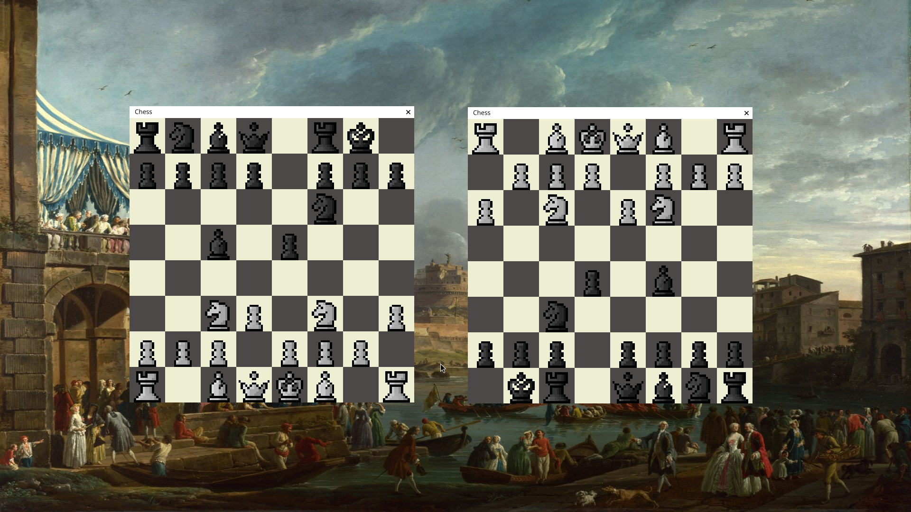

# Chess Lan

A **simple chess game** built in **C++** using **SFML**. The project includes a **Makefile** for easy compilation and running. SFML libraries are included in the `bin` folder, so **no extra installation** is required.

---

<p align="center">
  
</p>

---

# How to Play

- This is a **Player vs Player** chess game over the **same network (LAN)**
- **Player 1** must start the game and wait for **Player 2** to join
- Once both players are connected, the game begins automatically 
- Use your **mouse** to select and move pieces  
- Standard chess rules apply  

---

## Requirements

- C++ compiler (**g++**)  
- **Make**  
- **SFML 2.6** (included in the `bin` folder)  

---

## Getting Started

Clone the repository and navigate to the project folder:

```bash
git clone https://github.com/ikamania/chess-lan.git
cd chess-lan
```

## Build and Run

This project uses a Makefile for easy compilation and execution. Use the following commands:

- **Compile the project:**

```bash
make
```

- **Run the game:**

```bash
make run
```
